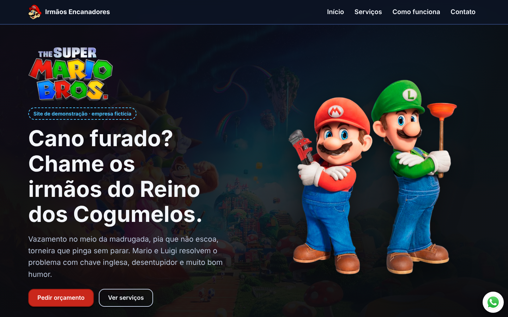

# Irmãos Encanadores Mario & Luigi

Site de demonstração de uma **empresa fictícia de encanadores** inspirada em Mario e Luigi, feito com **HTML, CSS e JavaScript puros** (sem frameworks).

> ⚠️ **Aviso:** projeto **independente, educacional e sem fins comerciais**, inspirado em personagens de terceiros. **Não possui vínculo, afiliação ou endosso da Nintendo nem da Illumination.** A empresa, os serviços, o telefone/WhatsApp e o formulário são apenas demonstrações: nenhum atendimento real é prestado.



## Objetivo

O projeto nasceu de um exercício passo a passo do curso **DevClub** (material base do repositório do Rodolfo Mori). Aqui ele foi evoluído para praticar:

- identidade visual própria sobre uma base existente;
- layout responsivo com Flexbox, CSS Grid e `clamp()`;
- HTML semântico e acessibilidade;
- organização de um projeto estático para publicação no GitHub Pages.

## Funcionalidades

- Cabeçalho fixo com navegação por âncoras (Início, Serviços, Como funciona, Contato).
- Seção inicial (hero) com vídeo de fundo, título e chamadas para ação.
- Seção **Serviços** com 6 cartões, benefícios e chamada para orçamento.
- Seção **Como funciona** (3 passos) e seção de **Contato**.
- Formulário de orçamento em janela modal (`<dialog>`), com campos obrigatórios, fechamento por `Esc`, botão ou clique fora, e mensagem de sucesso/erro sem sair da página.
- Botão flutuante e botão de contato com link para o WhatsApp (número de demonstração).
- Botão para pausar/reproduzir o vídeo de fundo; o vídeo já começa pausado para quem usa "reduzir movimento" no sistema.
- Link "Pular para o conteúdo" para quem navega por teclado.

## Tecnologias

- HTML5 semântico
- CSS3 (variáveis, Grid, Flexbox, `clamp()`, `prefers-reduced-motion`)
- JavaScript (ES6+), sem bibliotecas
- Fontes [Fredoka](https://fonts.google.com/specimen/Fredoka) e [Mukta](https://fonts.google.com/specimen/Mukta) via Google Fonts (com fontes do sistema como alternativa)
- [Formcarry](https://formcarry.com/) para receber o formulário de demonstração

## Estrutura de arquivos

```
.
├── index.html            # Página única (todas as seções)
├── style.css             # Estilos
├── scripts.js            # Formulário (dialog) e controle do vídeo
├── favicon.svg           # Favicon vetorial (criação própria)
├── favicon.ico           # Favicon 16/32/48 px
├── apple-touch-icon.png  # Ícone 180x180
├── assets/
│   ├── logo.png          # Logotipo do filme (usado no hero)
│   ├── logo-header.png   # Ícone usado no cabeçalho
│   ├── mario.png         # Mario e Luigi (hero)
│   ├── luigi.png         # Luigi (seção de contato)
│   ├── whatsapp.png      # Ícone do WhatsApp
│   ├── fundo-poster.jpg  # Imagem exibida antes/sem o vídeo
│   └── video.mp4         # Vídeo de fundo (versão comprimida, sem áudio)
├── docs/                 # Capturas de tela usadas neste README
└── README.md
```

## Como executar localmente

Não há dependências nem etapa de build.

**Opção 1 — abrir direto:** dê dois cliques em `index.html`.

**Opção 2 — servidor local (recomendado):**

```bash
# na pasta do projeto
python3 -m http.server 8000
# abra http://localhost:8000
```

Também funciona com a extensão *Live Server* do VS Code.

> O envio do formulário e as fontes do Google exigem internet.

## Publicar no GitHub Pages

1. Envie os arquivos para um repositório no GitHub.
2. Em **Settings → Pages**, escolha *Deploy from a branch*, branch `main` e pasta `/ (root)`.
3. Aguarde alguns minutos: o site ficará em `https://SEU-USUARIO.github.io/NOME-DO-REPOSITORIO/`.

Todos os caminhos são relativos, então funcionam na raiz do domínio e em subpastas.

## Responsividade e acessibilidade

Verificado com Chromium automatizado (Playwright) em 320, 360, 390, 568×320 (horizontal), 768, 1024, 1280, 1440, 1920 e 3440 px de largura: sem rolagem horizontal, sem imagens quebradas e com layout reorganizando-se de forma fluida.

Recursos aplicados: grids com `minmax()`, tipografia com `clamp()`, `100svh`, vídeo com `object-fit: cover`, alvos de toque com pelo menos 44 px, foco visível, `<label>` nos campos, `alt` descritivo nas imagens informativas, navegação por teclado, `Esc` fecha o formulário e respeito à preferência por movimento reduzido. Contraste dos textos principais acima de 4,5:1 (calculado).

**Ainda não testado:** leitores de tela reais, Safari/Firefox e dispositivos físicos. Se encontrar algum problema, abra uma *issue*.

## Créditos e origem dos recursos

- Estrutura e materiais iniciais (imagens, vídeo e primeira versão do código) vieram do repositório do curso **DevClub**, do **Rodolfo Mori**, e são usados **apenas para estudo e demonstração**.
- Mario, Luigi e elementos relacionados pertencem aos seus respectivos detentores de direitos (Nintendo / Illumination). Este projeto **não é oficial**.
- Favicon, textos, identidade visual, layout e código atual: criados para este projeto.
- Fontes: Fredoka e Mukta (SIL Open Font License) via Google Fonts.

Se você é detentor dos direitos e deseja a remoção de algum material, abra uma *issue* ou entre em contato.

## Próximas melhorias

- Substituir as imagens por ilustrações originais.
- Testar em mais navegadores e com leitores de tela.
- Adicionar depoimentos apenas se forem reais (nenhum é inventado hoje).

## Licença

Nenhuma licença foi definida para este repositório até o momento. Os materiais de terceiros citados acima mantêm seus direitos originais.
